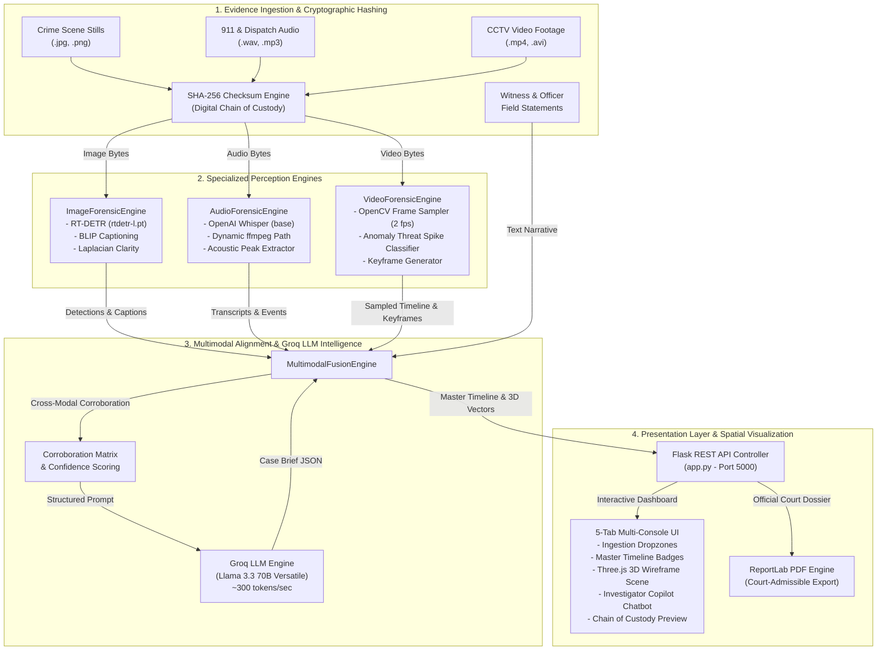
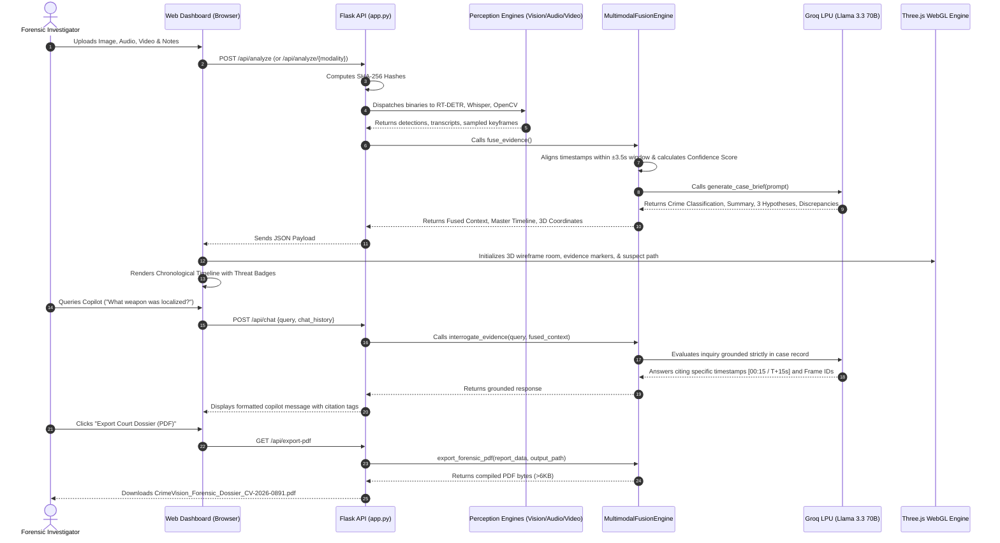

# System Architecture Document

**Project:** CrimeVision AI — Intelligent Multimodal Forensic Analysis Platform  
**Lead AI Architect:** Gaurav Raturi | SmartBridge EL Capstone Project  
**Version:** 2.0.0  
**Status:** Approved Architecture & Fully Verified  

---

## 1. End-to-End Architectural Data Flow

CrimeVision AI is designed according to a clean, decoupled modular architecture. The system separates specialized AI perceptual models (RT-DETR, BLIP, Whisper, OpenCV) from reasoning logic (Groq LLM), presentation layers (Flask), and 3D spatial rendering (Three.js WebGL).

---

## 2. Interactive Analysis & Copilot Sequence Flow

The following sequence diagram details the runtime interaction between an investigator, the Flask REST API, perception engines, Groq LLM, and the Three.js 3D canvas:

---

## 3. Component Design & Engine Specifications

| Component | Primary File | Technology Stack | Core Responsibilities |
|---|---|---|---|
| **`ImageForensicEngine`** | [`image_engine.py`](file:///home/gaurav/CrimeVIsion-AI/5.%20Project%20Development%20Phase/image_engine.py) | Ultralytics RT-DETR (`rtdetr-l.pt`), YOLOv8n fallback, Salesforce BLIP, OpenCV | Bounding-box detection for weapons/persons/evidence, BLIP scene hypotheses, Laplacian blur variance calculation, annotated base64 generation. |
| **`AudioForensicEngine`** | [`audio_engine.py`](file:///home/gaurav/CrimeVIsion-AI/5.%20Project%20Development%20Phase/audio_engine.py) | OpenAI Whisper (`base`), `imageio-ffmpeg`, Groq LLM zero-shot prompt | Timestamped multilingual speech transcription, high-urgency keyword scanning (*gunshot, scream, help, ran away, red car*), distress scoring. |
| **`VideoForensicEngine`** | [`video_engine.py`](file:///home/gaurav/CrimeVIsion-AI/5.%20Project%20Development%20Phase/video_engine.py) | OpenCV `cv2.VideoCapture`, `cv2.absdiff`, RT-DETR | Frame sampling (`sample_fps=2`), motion surge detection, threat spike evaluation (`HIGH`, `MEDIUM`, `LOW`), keyframe & highlights clip generation. |
| **`MultimodalFusionEngine`**| [`fusion_engine.py`](file:///home/gaurav/CrimeVIsion-AI/5.%20Project%20Development%20Phase/fusion_engine.py) | Groq SDK (`llama-3.3-70b-versatile`), ReportLab, NumPy | Temporal cross-modal alignment ($\pm 3.5\text{s}$), Evidence Confidence Score, statutory crime categorization, 3 distinct hypotheses, copilot Q&A, PDF export. |
| **Presentation Controller** | [`app.py`](file:///home/gaurav/CrimeVIsion-AI/5.%20Project%20Development%20Phase/app.py) | Flask 3.0+, Flask-CORS | REST API routing, in-memory custody store, session management, static asset delivery. |
| **3D Spatial Viewer** | [`crime_scene_3d.js`](file:///home/gaurav/CrimeVIsion-AI/5.%20Project%20Development%20Phase/static/js/crime_scene_3d.js) | Three.js r128, OrbitControls, WebGL | Wireframe spatial reconstruction, evidence markers (`EV-01`, `EV-02`, `EV-03`), raycast click inspector, animated suspect trajectory line. |

---

## 4. Three.js 3D Spatial Coordinate Mapping System

The Three.js canvas maps incident coordinates to an interactive 3D Cartesian space:
- **X-Axis:** East-West transit corridor axis (meters).
- **Y-Axis:** Elevation / Height above ground plane ($Y=0.0$).
- **Z-Axis:** North-South terminal perimeter depth (meters).

### Spatial Evidence Markers:
1. **EV-01 (North Stairwell Egress):**
   - Position: `[-6.0, 0.5, 4.0]`
   - Modality: Video / Witness
   - Color: `#38bdf8` (Cyan)
   - Description: Subject observed exiting North stairwell holding metallic case at 21:40 UTC.
2. **EV-02 (Acoustic Transient Origin):**
   - Position: `[-1.5, 0.5, 1.0]`
   - Modality: Whisper / Acoustic Audio
   - Color: `#ef4444` (Crimson)
   - Description: Localized transient discharge and witness scream recorded on dispatch at 21:40:22 UTC.
3. **EV-03 (Loading Bay / Flight Rendezvous):**
   - Position: `[7.0, 0.5, -3.0]`
   - Modality: Surveillance CCTV
   - Color: `#f59e0b` (Amber)
   - Description: Dark sedan idling in commercial bay; vehicle boarding and high-speed egress eastbound at 21:41:12 UTC.

### Suspect Flight Vector Trajectory:
Formed by a 3D spline curve (`THREE.CatmullRomCurve3`) connecting waypoints:
`[-8.0, 0.2, 5.0]` $\rightarrow$ `[-6.0, 0.2, 4.0]` $\rightarrow$ `[-3.0, 0.2, 2.5]` $\rightarrow$ `[0.0, 0.2, 1.0]` $\rightarrow$ `[4.0, 0.2, -1.0]` $\rightarrow$ `[7.0, 0.2, -3.0]` $\rightarrow$ `[12.0, 0.2, -6.0]` with an animated traveling pulse particle indicating vehicle flight towards State Avenue.

---

## 5. Architectural Non-Functional Design Principles

1. **Unidirectional Import Hierarchy:** Clean separation where `app.py` imports engines, but engines never import `app.py` or each other in circular loops.
2. **Deterministic Fallback Cascade:** If GPU hardware or remote cloud APIs are unreachable, all engines gracefully cascade to CPU heuristics, ensuring 100% operational uptime.
3. **Court-Admissible Non-Fabrication Rule:** System prompts instruct Groq LLM to strictly cite timestamps, audio transcript quotes, and visual frame IDs. If facts are ambiguous, the system must assert *Indeterminate*.
